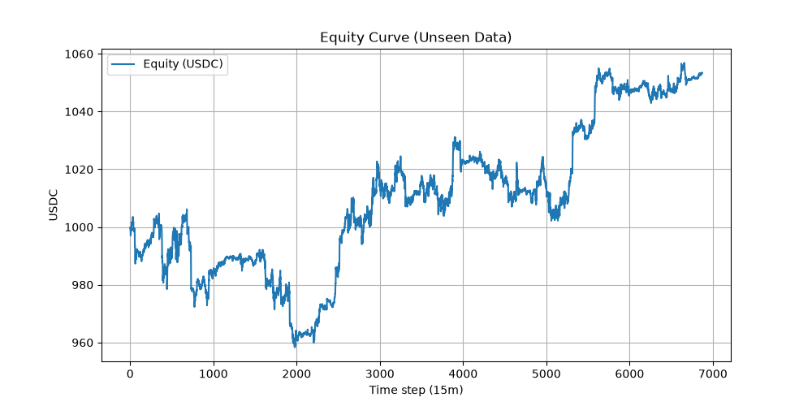

# Grid Trading Bot z uczeniem maszynowym

Przedstawiam bota, który służ do handlu kryptowalutami, opierający się na popularnej strategii Grid Trading. Aplikacja łączy się z API giełdy Bybit za pomocą biblioteki `ccxt`. Dodatkowo, aby bot radził sobie w różnych warunkach rynkowych, zaimplementowałem model uczenia maszynowego (K-Means), który dynamicznie dostosowuje szerokość siatki.

## Funkcjonalności
- **Dynamiczna siatka zleceń**: Zamiast polegać na sztywnych wartościach, bot wylicza odległości między zleceniami na bieżąco, wykorzystując wskaźnik ATR (Average True Range) oraz Wstęgi Bollingera.
- **Detekcja zmienności (K-Means)**: Model klastruje ostatnie zachowania rynku, aby wykryć, czy mamy obecnie fazę konsolidacji, czy podwyższonej zmienności, i na tej podstawie dobiera mnożniki siatki.
- **Działanie asynchroniczne**: Całość została napisana z wykorzystaniem biblioteki `asyncio`, dzięki czemu odpytywanie API giełdy i monitorowanie zleceń nie blokuje głównego wątku.
- **Odświeżanie modelu**: Wydzielony skrypt `retrainer.py` działa w tle i co określony czas pobiera nowe dane, aby ponownie przetrenować model, dzięki czemu bot nie korzysta z przestarzałych parametrów.
- **Baza danych**: Zrealizowane zlecenia są zapisywane do prostej bazy SQLite w celu późniejszej analizy.

## Użyte technologie
- Python 3.9+ (`asyncio`)
- `ccxt` - komunikacja z giełdą
- `pandas`, `pandas-ta`, `scikit-learn`, `numpy` - przetwarzanie danych i model ML
- `sqlite3` - przechowywanie historii transakcji

## Uruchomienie projektu

1. Zainstaluj wymagane pakiety:
   ```bash
   pip install -r requirements.txt
   ```
2. Stwórz plik `.env` w głównym katalogu i podaj swoje klucze API (domyślnie bot używa trybu testnet):
   ```env
   API_KEY=twoj_klucz_api
   SECRET_KEY=twoj_secret_key
   ```
3. Przygotuj dane i wygeneruj model ML. W tym celu uruchom kolejno:
   ```bash
   python data_fetcher.py
   python features_market.py
   python train_regime.py
   ```
4. Uruchom bota:
   ```bash
   python bot.py
   ```

Do repozytorium dołączyłem również skrypt `backtester.py`, który pozwala na symulację działania bota na historycznych danych, bez ryzykowania prawdziwego kapitału.

Oraz testy jednostkowe (w folderze `tests/`), które można odpalić poleceniem:
```bash
pytest
```

## Wyniki z backtestów (12 miesięcy wstecz)

Poniżej przedstawiam wyniki z wygenerowanego testu historycznego na parze BTC/USDC (interwał 15-minutowy). 
Aby upewnić się, że model nie ulega zjawisku "przeuczenia" (overfitting), system wyodrębnia paczkę danych testowych (Unseen Data), na której model nie był wcześniej trenowany. 

Oto wynik z ostatnich 35 dni na zbiorze testowym, po uwzględnieniu standardowych opłat giełdowych (fee):



(W katalogu `research/` pracuję też nad rozwinięciem logiki o model Random Forest, który w przyszłości posłuży do predykcji kierunku rynku i nagłych spadków cen).